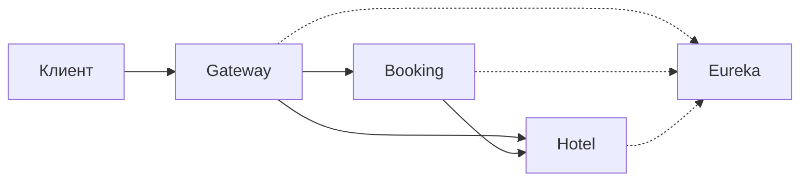

# Бронирование отелей

Учебный проект по Spring и REST API. Лачин Максим.

Можно посмотреть отели и свободные номера, забронировать номер вручную или через автоподбор, посмотреть свои брони и отменить их. Администратор управляет отелями, номерами и пользователями.

## Запуск

Нужны Java 21, Maven 3.8+, Python 3 и OpenSSL. Запуск и тесты рассчитаны на Linux. Из папки проекта:

```bash
./scripts/check.sh           # проверка стиля, тесты и сборка
python3 scripts/lab.py start # запуск четырёх приложений
python3 scripts/lab.py stop  # остановка
```

Первый запуск сборки скачает зависимости в `.work/m2`. Скрипт запуска создаст ключи и пароли. Пользователи: `maxim` (USER) и `admin` (ADMIN), пароли лежат в `.work/demo.json`.

| Сервис | Адрес |
|---|---|
| Gateway — вход в API | http://localhost:8080 |
| Hotel — Swagger | http://localhost:8081/swagger-ui.html |
| Booking — Swagger | http://localhost:8082/swagger-ui.html |
| Eureka | http://localhost:8761 |

В базе уже есть два отеля и пять номеров. Один номер снят с продажи. H2 хранит данные в памяти: после перезапуска всё вернётся к начальным данным.

Все сервисы слушают localhost. Основные настройки перечислены в `.env.example`; менять их нужно через переменные окружения, файл сам не подхватывается. Логи — в `.work/*.log`.

## Проверка

```bash
./scripts/check.sh        # JUnit, MockMvc, WebTestClient и Spotless
python3 scripts/smoke.py  # проверка через Gateway; стенд должен быть запущен
```

Тесты проверяют права доступа, даты, повторные запросы, одновременные бронирования, тайм-ауты и отмену при сбое Hotel. Отчёты JUnit лежат в `*/target/surefire-reports/`.

`smoke.py` проходит API целиком: CRUD, вход, создание и отмену брони. Отдельно отправляет 8 заявок на один номер и 8 копий одного запроса, затем проверяет автоподбор. Он добавляет данные в учебную базу. Для нестандартных портов задаются `API_URL`, `HOTEL_PORT`, `BOOKING_PORT` и `EUREKA_URL`.

Вручную удобнее проверять через Swagger. Сначала получить токен:

```bash
curl -s http://localhost:8080/api/users/auth \
  -H 'Content-Type: application/json' \
  -d '{"username":"maxim","password":"ПАРОЛЬ_ИЗ_demo.json"}'
```

Значение `accessToken` вставить в **Authorize**. Для запросов через curl:

```bash
export TOKEN='accessToken из ответа'
export START=$(date -d '+10 days' +%F)
export END=$(date -d '+12 days' +%F)
export REQUEST_ID=$(python3 -c 'import uuid; print(uuid.uuid4())')

curl -s http://localhost:8080/api/bookings \
  -H "Authorization: Bearer $TOKEN" -H 'Content-Type: application/json' \
  -d "{\"requestId\":\"$REQUEST_ID\",\"autoSelect\":true,\"startDate\":\"$START\",\"endDate\":\"$END\"}"
```

Если повторить этот запрос, новая бронь не появится. Если оставить `requestId`, но изменить даты или номер, вернётся 409.

## Эндпойнты

Все публичные пути ниже доступны через Gateway. Для списков есть `page` и `size`: по умолчанию 0 и 20, максимум 100 записей на страницу. Даты передаются как `YYYY-MM-DD`.

### Пользователи

| Метод и путь | Доступ | Действие / поля запроса |
|---|---|---|
| `POST /api/users/register` | Без входа | Регистрация USER: `username`, `password`; возвращает JWT |
| `POST /api/users/auth` | Без входа | Вход: `username`, `password`; возвращает JWT |
| `GET /api/users` | ADMIN | Список пользователей |
| `GET /api/users/{id}` | ADMIN | Один пользователь |
| `POST /api/users` | ADMIN | Создать: `username`, `password`, `role` (USER или ADMIN) |
| `PATCH /api/users/{id}` | ADMIN | Изменить переданные `username`, `password`, `role` |
| `DELETE /api/users/{id}` | ADMIN | Удалить пользователя без истории бронирований |

Логин: 3–50 латинских букв, цифр или символов `_.-`. Пароль: 8–72 символа. JWT действует час; смена роли не меняет уже выданный токен.

### Бронирования

Все операции — для USER и только со своими бронями.

| Метод и путь | Действие / поля запроса |
|---|---|
| `POST /api/bookings` | Создать: `requestId` (UUID), `autoSelect`, `roomId`, `hotelId`, `startDate`, `endDate` |
| `GET /api/bookings` | История бронирований |
| `GET /api/bookings/{id}` | Бронь по UUID |
| `DELETE /api/bookings/{id}` | Отменить бронь |
| `GET /api/bookings/recommendations` | Рекомендации на `startDate`, `endDate`; необязательный `hotelId` |

При `autoSelect:false` нужен `roomId`. При `autoSelect:true` он игнорируется, а `hotelId` можно использовать для выбора отеля. Рекомендации идут по `timesBooked`, затем по `id`; Booking получает первые 100 номеров и выбирает первый.

Заезд не может быть в прошлом, выезд должен быть позже заезда. День выезда доступен следующему гостю. Чтобы поменять даты, нужно отменить бронь и создать новую.

### Отели и номера

Чтение доступно USER и ADMIN, изменения и статистика — только ADMIN.

| Метод и путь | Действие / поля запроса |
|---|---|
| `GET /api/hotels` | Отели; `search` ищет по названию или адресу |
| `GET /api/hotels/{id}` | Один отель |
| `POST /api/hotels` | Создать: `name`, `address` |
| `PUT /api/hotels/{id}` | Изменить: `name`, `address` |
| `DELETE /api/hotels/{id}` | Удалить отель без номеров |
| `GET /api/rooms` | Свободные номера: `startDate`, `endDate`, необязательный `hotelId` |
| `GET /api/rooms/recommend` | Те же фильтры, сортировка по числу бронирований и id |
| `GET /api/rooms/{id}` | Один номер, в том числе снятый с продажи |
| `POST /api/rooms` | Создать: `hotelId`, `number`, `available` |
| `PUT /api/rooms/{id}` | Изменить: `number`, `available` |
| `DELETE /api/rooms/{id}` | Удалить номер без истории бронирований |
| `GET /api/rooms/statistics` | Загрузка за период: `startDate`, `endDate` |

`available:false` снимает номер с продажи, например на время ремонта. Занятость по датам проверяется отдельно. `timesBooked` учитывает все успешные выделения номера, включая отменённые; повторы запроса его не увеличивают. Статистика показывает занятые ночи и процент загрузки без отменённых броней.

Внутренние операции Hotel доступны только Booking с ролью SERVICE, через Gateway не проходят:

| Метод и путь | Действие |
|---|---|
| `POST /api/rooms/{id}/confirm-availability` | Занять период |
| `POST /api/rooms/{id}/release` | Освободить период |

Оба принимают `bookingId`, `startDate`, `endDate`. Повтор с теми же данными безопасен.

`GET /actuator/health` есть у каждого приложения. OpenAPI доступен по `/v3/api-docs` у Hotel и Booking. Служебные пути Eureka — `/eureka/**`.

## Устройство



`booking-service` отвечает за пользователей и брони, `hotel-service` — за каталог и занятость. `gateway` направляет запросы, `discovery-server` поднимает Eureka. В `common` лежат общие проверки JWT, ошибки и обработка идентификатора запроса.

В сервисах выделены `api`, `service`, `repository`, `domain`. HTTP-клиент Hotel реализует интерфейс `HotelClient`. Подробности транзакций и схема БД — в [docs/design.md](docs/design.md).

Основные ответы: 400 — неверный запрос, 401 — нужен действующий токен, 403 — нет прав, 404 — объект не найден или бронь чужая, 409 — конфликт, 503 — сервис недоступен. Для поиска ошибки в логах есть `traceId`, для шагов бронирования — `bookingId`.
